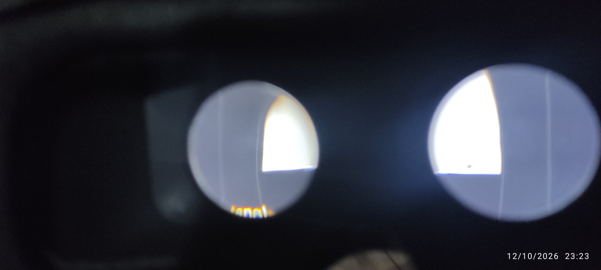
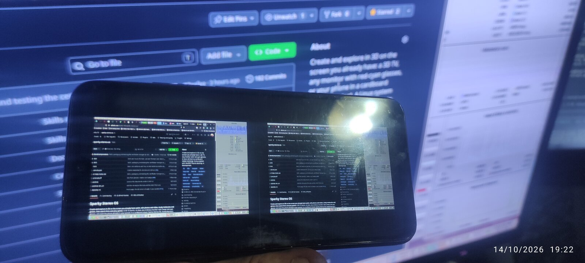
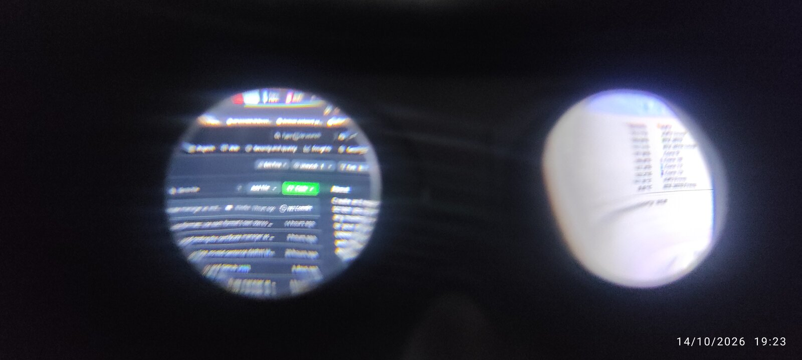
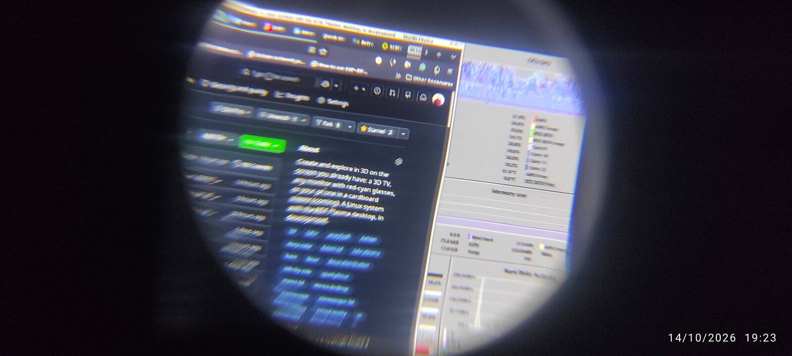

# Flat Headset

Flat Headset is a planned way to use a phone in a Cardboard-style viewer as a 3D screen for a Linux desktop. It shows the desktop in stereo without head tracking.

## How it works

KWin, KDE Plasma's compositor, as built for Sparky Stereo OS, will add a virtual output in the headset's mode: each eye is drawn at full sharpness on its own half of the phone screen, at the panel's native resolution. Programs continue to provide full side-by-side images, as they do elsewhere in Sparky Stereo OS.

KRdp, KDE's RDP server, will stream that output, with hardware video encoding where available. It already creates virtual monitors (`krdpserver --virtual-monitor`).

KDE Connect can pair the phone, find its address and hand it the stream, building on its virtual monitor plugin and on Fabian Druschke's remote desktop work for KDE Connect on the desktop and on Android. The viewer will also accept an address entered by the user.

A small phone viewer, built on FreeRDP's Android library and the open Cardboard SDK, will show the stream with lens correction. It will read the lens profile from the viewer's QR code.

When the phone connects, the desktop is planned to add a monitor in the viewer's mode and at the phone's resolution, like a 3D TV when it is plugged in.

Sound stays on the PC by default and plays through the PC's headphones or speakers. A setting will let the user stream sound to the phone.

The viewer is also planned to act as a DLNA renderer. Universal Media Server or another DLNA server can send it a movie for decoding on the phone: a stereo movie shows split per eye, a 2D movie as one flat screen to both eyes.

KDE Connect is optional: the phone can also be found on the local network through UPnP, or connected by USB.

The full VR mode with head tracking is a separate project.

## Status

Flat Headset is in development as part of Sparky Stereo OS. There is nothing to install yet.
On 12 October 2026 the first test passed on Daniel's phone (a Xiaomi Redmi Note 9 Pro) in a VR Shinecon viewer: movie mode, and a desktop test chart streamed to the phone, each eye on its own half with the lens correction fitted for that viewer.
On 13 October the phone mirrored the real 3D desktop for the first time; the stream stopped refreshing after half a minute, and that fix is in progress.

## The first test, 12 October 2026

 

*The streamed chart on the phone, the same chart through the lenses, and the phone in the VR Shinecon viewer. Photos by Daniel Ramos, CC BY 4.0.*

## The desktop on the phone, 14 October 2026

 

*The PC's desktop thrown to the phone: the phone in front of the monitor it mirrors, both lenses photographed from between them (one camera there sees the outer side of each view, while each eye sees its whole view), and one lens up close. Photos by Daniel Ramos, CC BY 4.0.*

## Sparky Stereo OS

Flat Headset is part of [Sparky Stereo OS](https://github.com/Sparky-OS/sparky-stereo-os). Its design follows the [house formats](https://github.com/Sparky-OS/sparky-stereo-os/blob/main/docs/house-formats.md) used by that project.

Sparky Stereo OS, Daniel Ramos's edition of SparkyLinux (by Paweł "pavroo" Pijanowski).

Licence: GPL-2.0-only OR GPL-3.0-only OR LicenseRef-KDE-Accepted-GPL, the licence of KDE Connect for Android, so the code can go upstream to KDE unchanged (texts in `LICENSES/`).
